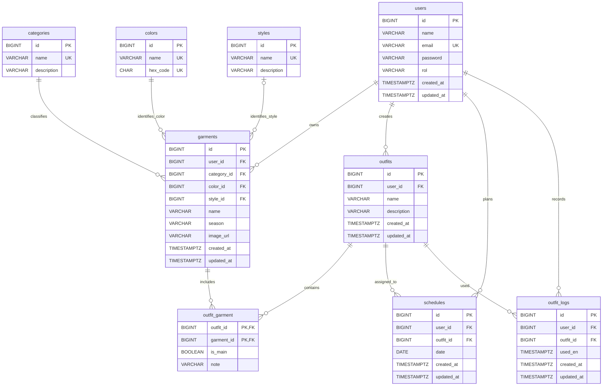

# Modelo Entidad-Relacion de SmartStylist

Este documento propone el modelo relacional para el MVP backend de SmartStylist. Los nombres de tablas y campos usan `snake_case`. El motor previsto en el anteproyecto es PostgreSQL; los tipos y restricciones deben implementarse en migraciones Laravel/Eloquent, no mediante volcados SQL manuales.

El modelo cubre usuarios y roles, catalogos, armarios personales, outfits, planificacion semanal y registro de uso para las estadisticas. Las sugerencias se calculan con reglas de negocio a partir de las garments del usuario; no se almacenan como entidad mientras el usuario no decida guardar el outfit.

## 1. Decisiones del modelo

1. **Propiedad:** cada prenda y outfit pertenece a un usuario. La API siempre determina el propietario desde la identidad autenticada; no confia en un `user_id` enviado por el cliente.
2. **Roles:** para el MVP cada cuenta tiene un unico rol (`admin` o `user`) almacenado en `users.rol`. Los invitados no son filas de la base: son peticiones sin autenticar y solo pueden acceder a las rutas publicas permitidas.
3. **Catalogos:** categoria, color y estilo son entidades separadas y compartidas. Una prenda tiene una categoria, un color principal y un estilo opcional. La temporada es un valor limitado y validado, no una etiqueta libre.
4. **Outfits en borrador:** se permite crear un outfit vacio y completarlo despues. Antes de considerarlo completo, el backend exige al menos una prenda y al menos una marcada como principal.
5. **Calendario MVP:** se propone un outfit por usuario y fecha. Si se necesitan varios outfits el mismo dia, se elimina la restriccion `UNIQUE (user_id, date)`.
6. **Estadisticas:** planificar un outfit no significa que se haya usado. `outfit_logs` registra cada uso confirmado. Las garments mas/menos usadas y combinaciones frecuentes se calculan consultando ese historial y `outfit_garment`.
7. **Imagenes:** se almacena una ruta/URL por prenda, no el contenido del fichero. Se empieza con una imagen opcional; una entidad separada para multiples imagenes podria anadirse si el producto lo requiere.
8. **Tokens JWT:** son credenciales de autenticacion, no entidades de negocio del armario. La revocacion/denylist, si la biblioteca elegida la necesita para logout, es una decision de infraestructura y no forma parte del modelo funcional base.

## 2. Entidades y relaciones

- Un usuario tiene muchas garments y muchos outfits; cada prenda y outfit tiene exactamente un propietario.
- Una categoria y un color clasifican muchas garments. Un estilo puede clasificar muchas garments; una prenda puede no tener estilo.
- Un outfit y una prenda se relacionan N:M mediante `outfit_garment`, que incluye atributos propios (`is_main`, `note`).
- Un usuario tiene muchas schedules y cada planificacion referencia un outfit de ese mismo usuario.
- Un usuario tiene muchos registros de uso y cada registro referencia un outfit de ese mismo usuario.
- El rol administrador mantiene los catalogos. El rol usuario gestiona sus recursos personales. Esta autorizacion se aplica en la API; no requiere una tabla de permisos para los dos roles actuales.

## 3. Definicion de las tablas

Los tipos se expresan en terminos de PostgreSQL. `BIGINT GENERATED BY DEFAULT AS IDENTITY` representa identificadores autoincrementales. Las restricciones `ON DELETE` deben declararse en migraciones.

### `users`

Cuentas registradas. La tabla de Laravel tambien es necesaria para autenticacion y relaciones de propiedad.

| Campo | Tipo PostgreSQL | Restricciones | Descripcion |
| --- | --- | --- | --- |
| `id` | `BIGINT` | PK, GENERATED BY DEFAULT AS IDENTITY | Identificador de usuario. |
| `name` | `VARCHAR(255)` | NOT NULL | Nombre visible. |
| `email` | `VARCHAR(255)` | NOT NULL, UNIQUE | Correo de acceso. |
| `email_verified_at` | `TIMESTAMPTZ` | NULL | Fecha de verificacion, si se habilita. |
| `password` | `VARCHAR(255)` | NOT NULL | Hash adaptativo bcrypt (coste >= 10) o Argon2id; nunca se devuelve por la API. |
| `rol` | `VARCHAR(20)` | NOT NULL, DEFAULT `'user'`, CHECK (`rol` IN (`'admin'`, `'user'`)) | Perfil de autorizacion. El registro publico siempre asigna `user`. |
| `remember_token` | `VARCHAR(100)` | NULL | Campo convencional de Laravel; no sustituye al JWT. |
| `created_at` | `TIMESTAMPTZ` | NOT NULL | Fecha de alta. |
| `updated_at` | `TIMESTAMPTZ` | NOT NULL | Fecha de ultima modificacion. |

Si en el futuro una persona puede tener varios roles o los administradores pueden definir roles, sustituir `users.rol` por `roles` y una tabla intermedia `role_user`. Para el alcance actual, esa complejidad no es necesaria.

### `categories`

Catalogo de tipos de prenda, por ejemplo camiseta, pantalon, vestido o calzado. Su CRUD de escritura se reserva a administradores.

| Campo | Tipo PostgreSQL | Restricciones | Descripcion |
| --- | --- | --- | --- |
| `id` | `BIGINT` | PK, GENERATED BY DEFAULT AS IDENTITY | Identificador de categoria. |
| `name` | `VARCHAR(80)` | NOT NULL, UNIQUE | Nombre unico. |
| `description` | `VARCHAR(255)` | NULL | Descripcion opcional. |

### `colors`

Catalogo independiente de colores.

| Campo | Tipo PostgreSQL | Restricciones | Descripcion |
| --- | --- | --- | --- |
| `id` | `BIGINT` | PK, GENERATED BY DEFAULT AS IDENTITY | Identificador de color. |
| `name` | `VARCHAR(50)` | NOT NULL, UNIQUE | Nombre unico. |
| `hex_code` | `CHAR(7)` | NULL, UNIQUE, CHECK (formato `#RRGGBB`) | Codigo hexadecimal opcional. PostgreSQL permite multiples valores NULL en una restriccion UNIQUE ordinaria. |

### `styles`

Catalogo de estilos, por ejemplo casual, formal o deportivo.

| Campo | Tipo PostgreSQL | Restricciones | Descripcion |
| --- | --- | --- | --- |
| `id` | `BIGINT` | PK, GENERATED BY DEFAULT AS IDENTITY | Identificador de estilo. |
| `name` | `VARCHAR(80)` | NOT NULL, UNIQUE | Nombre unico. |
| `description` | `VARCHAR(255)` | NULL | Descripcion opcional. |

### `garments`

garments del armario personal. Cada registro pertenece a un usuario.

| Campo | Tipo PostgreSQL | Restricciones | Descripcion |
| --- | --- | --- | --- |
| `id` | `BIGINT` | PK, GENERATED BY DEFAULT AS IDENTITY | Identificador de prenda. |
| `user_id` | `BIGINT` | NOT NULL, FK → `users.id` ON DELETE CASCADE | Propietario del armario. |
| `category_id` | `BIGINT` | NOT NULL, FK → `categories.id` ON DELETE RESTRICT | Categoria de la prenda. |
| `color_id` | `BIGINT` | NOT NULL, FK → `colors.id` ON DELETE RESTRICT | Color principal. |
| `style_id` | `BIGINT` | NULL, FK → `styles.id` ON DELETE RESTRICT | Estilo opcional. |
| `name` | `VARCHAR(120)` | NOT NULL | Nombre descriptivo. |
| `season` | `VARCHAR(20)` | NULL, CHECK (valor permitido) | `primavera`, `verano`, `otono`, `invierno` o `todas`. |
| `image_url` | `VARCHAR(2048)` | NULL | Ruta/URL de la imagen; el binario reside en almacenamiento de ficheros. |
| `created_at` | `TIMESTAMPTZ` | NOT NULL | Fecha de alta. |
| `updated_at` | `TIMESTAMPTZ` | NOT NULL | Fecha de ultima modificacion. |

Una prenda tiene un unico color principal y como maximo un estilo. Si en el futuro se quieren varios colores o estilos por prenda, se anadiran relaciones N:M especificas. No se crea una tabla generica de etiquetas porque el alcance actual ya distingue categoria, color, estilo y temporada.

### `outfits`

Conjuntos guardados por usuarios. Se pueden crear como borrador antes de asignarles garments.

| Campo | Tipo PostgreSQL | Restricciones | Descripcion |
| --- | --- | --- | --- |
| `id` | `BIGINT` | PK, GENERATED BY DEFAULT AS IDENTITY | Identificador del outfit. |
| `user_id` | `BIGINT` | NOT NULL, FK → `users.id` ON DELETE CASCADE | Propietario del outfit. |
| `name` | `VARCHAR(120)` | NOT NULL | Nombre descriptivo; no es UNIQUE. |
| `description` | `VARCHAR(255)` | NULL | Descripcion opcional. |
| `created_at` | `TIMESTAMPTZ` | NOT NULL | Fecha de creacion. |
| `updated_at` | `TIMESTAMPTZ` | NOT NULL | Fecha de ultima modificacion. |

### `outfit_garment`

Tabla intermedia N:M que indica las garments de cada conjunto y el papel de cada prenda.

| Campo | Tipo PostgreSQL | Restricciones | Descripcion |
| --- | --- | --- | --- |
| `outfit_id` | `BIGINT` | PK compuesta, FK → `outfits.id` ON DELETE CASCADE | Outfit asociado. |
| `garment_id` | `BIGINT` | PK compuesta, FK → `garments.id` ON DELETE CASCADE | Prenda asociada. |
| `is_main` | `BOOLEAN` | NOT NULL, DEFAULT `FALSE` | Indica si la prenda es principal. Puede haber varias principales. |
| `note` | `VARCHAR(255)` | NULL | Nota contextual, por ejemplo «llevar abierta». |

Restricciones y reglas:

- PK compuesta (`outfit_id`, `garment_id`): una prenda no se repite en el mismo outfit.
- La base de datos garantiza que outfit y prenda existen. El servicio debe comprobar que pertenecen al mismo usuario antes de insertar la relacion.
- El servicio debe comprobar que un outfit completo contiene al menos una prenda y al menos una prenda principal. Es una regla entre filas y no se resuelve con un `CHECK` ordinario.
- Las operaciones que sustituyan varias garments se ejecutan en una transaccion.

### `schedules`

Asigna un outfit a un dia del calendario del usuario.

| Campo | Tipo PostgreSQL | Restricciones | Descripcion |
| --- | --- | --- | --- |
| `id` | `BIGINT` | PK, GENERATED BY DEFAULT AS IDENTITY | Identificador de planificacion. |
| `user_id` | `BIGINT` | NOT NULL, FK → `users.id` ON DELETE CASCADE | Propietario de la planificacion. |
| `outfit_id` | `BIGINT` | NOT NULL, FK → `outfits.id` ON DELETE CASCADE | Outfit planificado. |
| `date` | `DATE` | NOT NULL | Dia planificado, en la zona horaria de la aplicacion. |
| `created_at` | `TIMESTAMPTZ` | NOT NULL | Fecha de creacion del registro. |
| `updated_at` | `TIMESTAMPTZ` | NOT NULL | Fecha de ultima modificacion. |

Restricciones y reglas:

- MVP propuesto: `UNIQUE (user_id, date)`, es decir, un outfit por usuario y dia. El usuario debe confirmar esta regla antes de crear la migracion; para permitir varios outfits diarios, no se anade esa restriccion.
- El servicio comprueba que `outfit_id` pertenece al mismo usuario y que el outfit esta completo.
- La planificacion es distinta del uso real: una fecha planificada no incrementa las estadisticas de uso.

### `outfit_logs`

Historial de outfits que el usuario marca como usados. Esta entidad hace posibles las estadisticas de garments mas/menos utilizadas y combinaciones frecuentes.

| Campo | Tipo PostgreSQL | Restricciones | Descripcion |
| --- | --- | --- | --- |
| `id` | `BIGINT` | PK, GENERATED BY DEFAULT AS IDENTITY | Identificador del evento de uso. |
| `user_id` | `BIGINT` | NOT NULL, FK → `users.id` ON DELETE CASCADE | Usuario que registra el uso. |
| `outfit_id` | `BIGINT` | NOT NULL, FK → `outfits.id` ON DELETE CASCADE | Outfit utilizado. |
| `used_in` | `TIMESTAMPTZ` | NOT NULL | Momento en que se uso el outfit. |
| `created_at` | `TIMESTAMPTZ` | NOT NULL | Momento en que se registro el evento. |
| `updated_at` | `TIMESTAMPTZ` | NOT NULL | Momento de ultima modificacion del registro. |

El servicio comprueba que el outfit pertenece al usuario. No se impone unicidad por usuario/outfit/fecha: si el usuario registra dos usos reales en momentos distintos, ambos eventos cuentan. Las estadisticas de garments y combinaciones se derivan uniendo `outfit_logs` con `outfit_garment`; no se duplican contadores que puedan quedar desactualizados.

## 4. Claves foraneas y politica de borrado

- `garments.user_id`, `outfits.user_id`, `schedules.user_id` y `outfit_logs.user_id`: `ON DELETE CASCADE`, para eliminar los datos personales asociados al eliminar la cuenta.
- `garments.category_id`, `garments.color_id`, `garments.style_id`: `ON DELETE RESTRICT`, para impedir borrar un valor de catalogo utilizado.
- `outfit_garment.outfit_id` y `outfit_garment.garment_id`: `ON DELETE CASCADE`, para borrar solo las filas pivot asociadas, no las otras garments ni otros outfits.
- `schedules.outfit_id` y `outfit_logs.outfit_id`: `ON DELETE CASCADE` en esta propuesta MVP. Borrar un outfit elimina sus schedules e historial de uso; por tanto, se pierden esas aportaciones a estadisticas. Si el negocio requiere conservar historial, se debe acordar una politica de archivado/soft delete antes de implementar.

La integridad referencial asegura que las referencias existen. Las comprobaciones de que el outfit y su prenda/planificacion/uso pertenecen al mismo usuario se realizan en la capa de servicio. Si se desea que PostgreSQL tambien impida esa discrepancia, se pueden anadir claves foraneas compuestas sobre (`id`, `user_id`) en las tablas propietarias; esto requiere claves `UNIQUE` compuestas y migraciones mas elaboradas.

## 5. Reglas de negocio que no son entidades

- **Sugerencias:** se calculan al solicitarlas, filtrando las garments del usuario por temporada, color, estilo y categorias compatibles. No se persisten hasta que se guardan como `outfits` y `outfit_garment`.
- **Estadisticas:** son consultas agregadas sobre `outfit_logs` y `outfit_garment`; no se almacenan contadores redundantes.
- **RBAC:** el middleware/policies de Laravel comprueba `users.rol`. No existe una fila para invitados; son visitantes sin sesion.
- **JWT:** la clave de firma vive en `.env`. Si la estrategia de logout exige revocacion antes de expirar, la biblioteca puede requerir almacenamiento tecnico de identificadores revocados; no forma parte del modelo de dominio.
- **Escaneo con IA e integracion con tiendas:** quedan fuera del MVP segun el anteproyecto.

## 6. Normalizacion (3FN)

- **Primera forma normal (1FN):** cada columna guarda un valor atomico. Las garments de un outfit no se guardan como listas dentro de `outfits`; se registran fila a fila en `outfit_garment`. Los catalogos no almacenan varios nombres en una columna.
- **Segunda forma normal (2FN):** en `outfit_garment`, cuyos atributos no clave son `is_main` y `note`, ambos describen la pareja completa (`outfit_id`, `garment_id`). Ninguno depende solo de una parte de la clave compuesta. Las demas tablas usan una clave primaria simple.
- **Tercera forma normal (3FN):** atributos de categories/colors/styles se guardan en sus catalogos, no se repiten en `garments`; `garments` referencia esos catalogos por clave. Los datos de usuario no se copian a garments, outfits, schedules ni usos. Los totales estadisticos no se duplican como contadores almacenados.

La regla «un outfit completo tiene una o mas garments principales» depende de multiples filas y se valida en el servicio dentro de una transaccion al completar o modificar el conjunto.

## 7. Diagrama entidad-relacion en Mermaid

## 8. Entidades propuestas para el futuro (no incluidas en el MVP actual)

- **`garment_images`:** si una prenda necesita varias fotos, separar cada fichero en una entidad con ruta, orden y metadatos. El MVP guarda una ruta en `garments.imagen_url`.
- **`roles` y `role_user`:** necesarios si una cuenta puede tener varios roles o si los roles se administran dinamicamente. Para `admin`/`user`, `users.rol` es suficiente.
- **`labels` y tabla pivot:** solo si las etiquetas dejan de corresponder a categoria/color/estilo/temporada y se necesitan etiquetas libres o multiples por prenda.
- **`jwt_revocations`/denylist:** almacenamiento tecnico opcional si la biblioteca JWT requiere invalidar tokens al cerrar sesion antes de su expiracion.
- **`notifications` o `preferences`:** no requeridas por los seis casos de uso actuales.

No se anaden estas entidades al esquema principal para no introducir complejidad sin un caso de uso aprobado.
