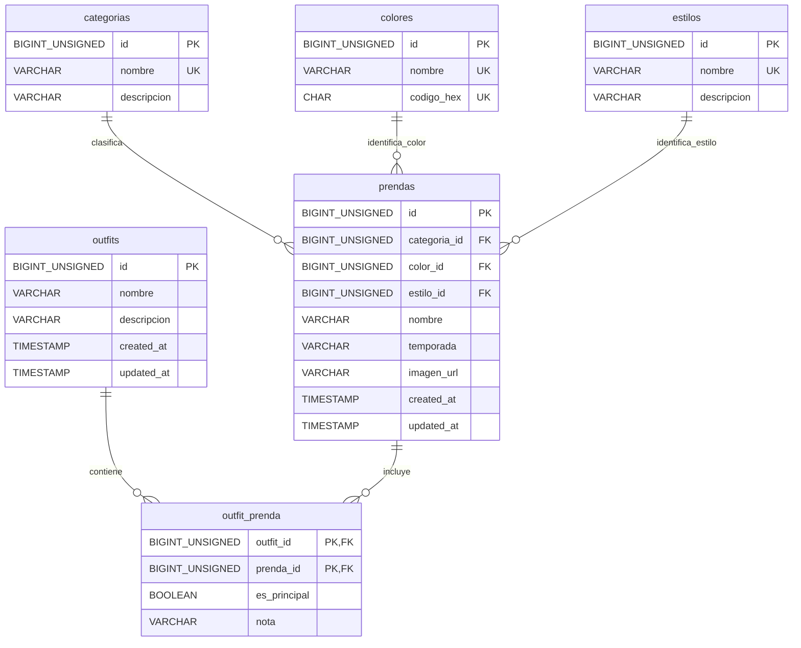

# Modelo Entidad-Relación de SmartStylist

Este documento define las entidades del armario digital y de los conjuntos (outfits). Los nombres de tablas y campos se escriben en `snake_case` para que se puedan reutilizar en MySQL y Laravel.

## 1. Entidades y relaciones

- Una **categoría** puede clasificar muchas prendas; cada prenda pertenece a una categoría.
- Un **color** puede estar asociado a muchas prendas; cada prenda tiene un color principal.
- Un **estilo** puede estar asociado a muchas prendas; una prenda puede no tener estilo o tener uno.
- Un **outfit** está formado por una o varias prendas.
- Una **prenda** puede formar parte de varios outfits. La relación M:N entre `outfits` y `prendas` se resuelve con `outfit_prenda`.
- La base de datos permite crear primero el outfit y añadir sus prendas después; el backend debe comprobar que tenga al menos una prenda antes de considerarlo completo.

## 2. Definición de las tablas

### `categorias`

Catálogo de tipos de prenda, por ejemplo: camiseta, pantalón, vestido o calzado.

| Campo | Tipo MySQL | Restricciones | Descripción |
| --- | --- | --- | --- |
| `id` | `BIGINT UNSIGNED` | PK, AUTO_INCREMENT | Identificador de la categoría. |
| `nombre` | `VARCHAR(80)` | NOT NULL, UNIQUE | Nombre único, por ejemplo, «Camiseta». |
| `descripcion` | `VARCHAR(255)` | NULL | Descripción opcional. |

### `colores`

Catálogo independiente de colores, por ejemplo: negro, blanco o azul. Se mantiene separado de los estilos para que cada entidad tenga un significado claro.

| Campo | Tipo MySQL | Restricciones | Descripción |
| --- | --- | --- | --- |
| `id` | `BIGINT UNSIGNED` | PK, AUTO_INCREMENT | Identificador del color. |
| `nombre` | `VARCHAR(50)` | NOT NULL, UNIQUE | Nombre único del color. |
| `codigo_hex` | `CHAR(7)` | NULL, UNIQUE | Código hexadecimal opcional, por ejemplo, `#FFFFFF`. |

### `estilos`

Catálogo de estilos que describen la apariencia de una prenda, por ejemplo: casual, formal o deportivo.

| Campo | Tipo MySQL | Restricciones | Descripción |
| --- | --- | --- | --- |
| `id` | `BIGINT UNSIGNED` | PK, AUTO_INCREMENT | Identificador del estilo. |
| `nombre` | `VARCHAR(80)` | NOT NULL, UNIQUE | Nombre único del estilo. |
| `descripcion` | `VARCHAR(255)` | NULL | Descripción opcional. |

### `prendas`

Cada fila representa una prenda del armario.

| Campo | Tipo MySQL | Restricciones | Descripción |
| --- | --- | --- | --- |
| `id` | `BIGINT UNSIGNED` | PK, AUTO_INCREMENT | Identificador de la prenda. |
| `categoria_id` | `BIGINT UNSIGNED` | NOT NULL, FK → `categorias.id` | Categoría a la que pertenece. |
| `color_id` | `BIGINT UNSIGNED` | NOT NULL, FK → `colores.id` | Color principal de la prenda. |
| `estilo_id` | `BIGINT UNSIGNED` | NULL, FK → `estilos.id` | Estilo asociado, si se conoce. |
| `nombre` | `VARCHAR(120)` | NOT NULL | Nombre descriptivo, por ejemplo, «Camisa blanca». |
| `temporada` | `VARCHAR(20)` | NULL | Temporada: `primavera`, `verano`, `otono`, `invierno` o `todo_el_ano`. |
| `imagen_url` | `VARCHAR(2048)` | NULL | Ruta o URL de la imagen. |
| `created_at` | `TIMESTAMP` | NOT NULL | Fecha y hora de creación del registro. |
| `updated_at` | `TIMESTAMP` | NOT NULL | Fecha y hora de la última actualización. |

`estilo_id` es opcional porque una prenda puede no tener un estilo asignado. En este modelo cada prenda tiene un único color principal y, como máximo, un estilo. Si en el futuro se necesitan varios colores o estilos por prenda, se podrán añadir relaciones M:N específicas.

### `outfits`

Cada fila representa un conjunto guardado.

| Campo | Tipo MySQL | Restricciones | Descripción |
| --- | --- | --- | --- |
| `id` | `BIGINT UNSIGNED` | PK, AUTO_INCREMENT | Identificador del outfit. |
| `nombre` | `VARCHAR(120)` | NOT NULL | Nombre del conjunto, por ejemplo, «Look de verano». |
| `descripcion` | `VARCHAR(255)` | NULL | Descripción opcional. |
| `created_at` | `TIMESTAMP` | NOT NULL | Fecha y hora de creación del registro. |
| `updated_at` | `TIMESTAMP` | NOT NULL | Fecha y hora de la última actualización. |

`nombre` no es UNIQUE: pueden existir varios outfits con el mismo nombre.

### `outfit_prenda`

Tabla intermedia para relacionar outfits con las prendas que los forman. Sus atributos describen la importancia y el uso de cada prenda concreta dentro de un outfit.

| Campo | Tipo MySQL | Restricciones | Descripción |
| --- | --- | --- | --- |
| `outfit_id` | `BIGINT UNSIGNED` | PK compuesta, FK → `outfits.id` | Outfit al que se añade la prenda. |
| `prenda_id` | `BIGINT UNSIGNED` | PK compuesta, FK → `prendas.id` | Prenda incluida en el outfit. |
| `es_principal` | `BOOLEAN` | NOT NULL, DEFAULT `FALSE` | Distingue las prendas que definen el conjunto (`TRUE`) de las que lo complementan (`FALSE`). Es útil para identificar rápidamente las piezas centrales del look y priorizarlas al mostrar o sugerir outfits. Un outfit puede tener varias prendas principales. |
| `nota` | `VARCHAR(255)` | NULL | Nota sobre su uso en ese conjunto, por ejemplo, «llevar abierta». |

Restricciones:

- PK compuesta (`outfit_id`, `prenda_id`): una misma prenda no se puede repetir en el mismo outfit.
- La base de datos permite marcar una o varias prendas del outfit como principales. El backend debe comprobar que cada outfit completo tenga al menos una prenda principal.

## 3. Claves foráneas y borrados

- Las claves foráneas de `prendas` a `categorias`, `colores` y `estilos` usan `ON DELETE RESTRICT`: no se puede borrar un valor del catálogo mientras esté asignado a alguna prenda.
- Las claves foráneas de `outfit_prenda` usan `ON DELETE CASCADE`: al borrar un outfit o una prenda, se eliminan sus relaciones correspondientes, pero no las otras prendas del outfit ni los otros outfits de la prenda.

## 4. Esquema de la base de datos en Mermaid

