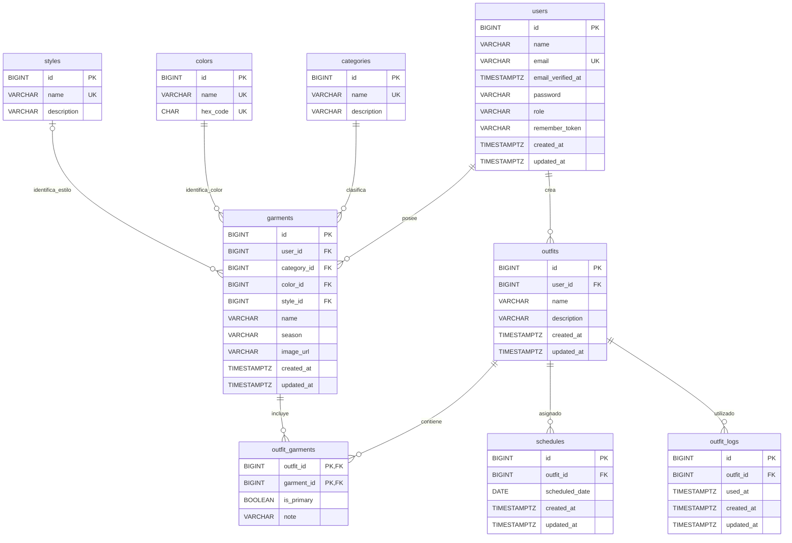

# Modelo Entidad-Relacion de SmartStylist - Diagrama entidad-relacion en Mermaid

El diagrama representa las entidades funcionales del proyecto. Excluye tablas internas de infraestructura creadas por Laravel, como `cache` y `cache_locks`.

